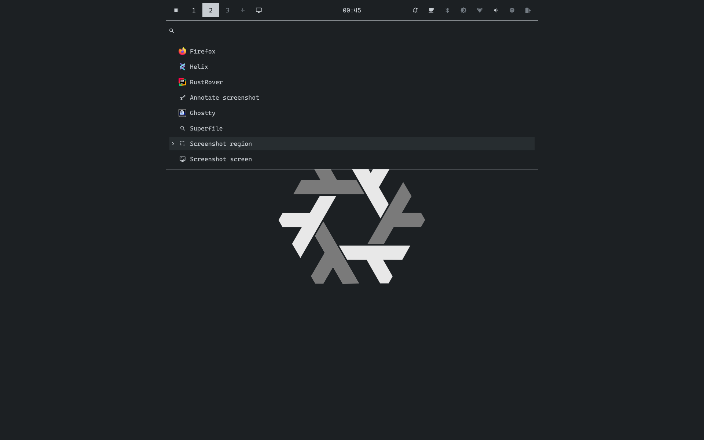

# OMDE

A minimal Quickshell setup with Mango that I use for my development workflow. 



## Install

OMDE is a flake. It exports `homeManagerModules.default`, `nixosModules.default`
and packages `default` (Quickshell with the logind and search plugins), `omde`
(the QML), `omde-logind` and `omde-search`.

With NixOS and Home Manager:

```nix
inputs.omde = {
  url = "github:arslan1510/OMDE";
  inputs.nixpkgs.follows = "nixpkgs";
};

# NixOS
imports = [ inputs.omde.nixosModules.default ];
# Home Manager
home-manager.sharedModules = [ { omde.enable = true; } ];
```

Home Manager on its own:

```nix
imports = [ inputs.omde.homeManagerModules.default ];

omde = {
  enable = true;
  clock.format = "HH:mm";
  bar.modules.tray = false;
};
```

OMDE needs Mango with its Home Manager module.
## Usage

By default, a systemd user service starts OMDE with the session and stops with
it. The service starts after the compositor's session target. Set
`omde.systemd.enable = false` to let Mango start `run` from `mango/omde.toml`
instead. Either way:

```sh
quickshell kill -c omde            
systemctl --user restart omde      
```

| Key | Action |
|---|---|
| `SUPER+space` | launcher |
| `SUPER+w` | launcher, open windows |
| `SUPER+v` | launcher, clipboard history |
| `SUPER+Escape` | lock |
| `Print` | screenshot a region |
| `SHIFT+Print` | screenshot the screen |
| `SUPER+Print` | screenshot a region into satty |

Volume, brightness and media keys are bound in `~/.config/mango/omde.toml`.

Don't create `~/.config/quickshell/shell.qml`: Quickshell would take it as the
default config and stop finding `omde/`.

## Configuration

Home Manager writes two files as store symlinks, so a rebuild doesn't reach the
running shell until you reload:

```sh
qs ipc -c omde call omde reloadTheme
qs ipc -c omde call omde reloadConfig
```

`palette.json` holds the theme (`omde.theme.*`).

`config.json` holds behaviour
from the matching `omde.*` options: bar cells, tags, widths, clock etc.

Defaults are in `qml/Scheme.qml` and `qml/Config.qml`.

See `modules/omde/default.nix` for every option.

## Development

`qml/` is the shell.

`search/` is the fuzzy matcher (`OMDE.Search`), a Rust core
with a small C++ QML shim.

`logind/` is a Qt plugin (`OMDE.Logind`).

`modules/` holds the flake and HM module.

```sh
nix build .#default
```

## License

MIT. The search core links [nucleo-matcher](https://github.com/helix-editor/nucleo),
which is MPL-2.0.
